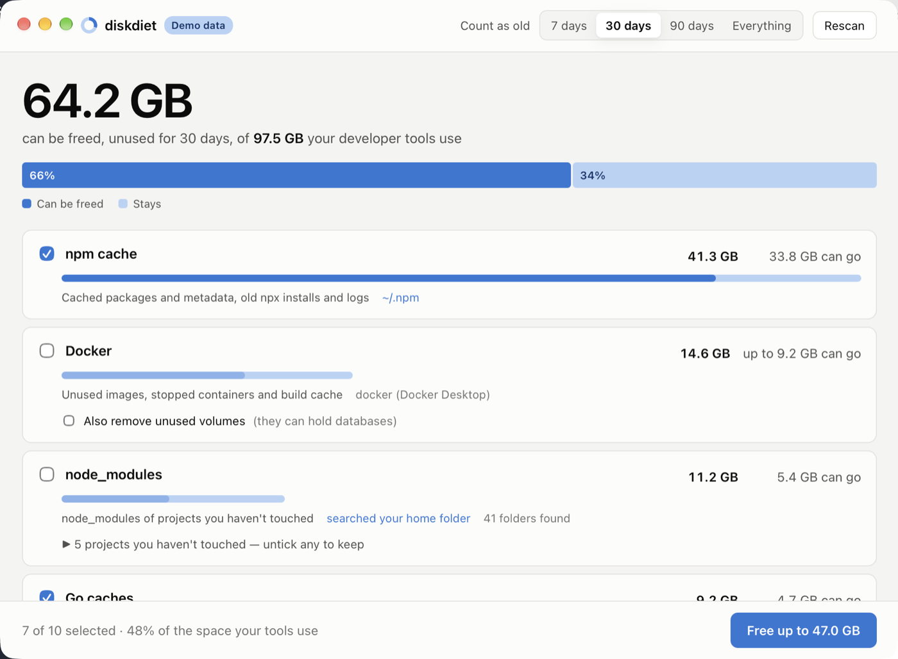

# diskdiet

**See where your developer disk space went, and get it back safely.**
One tool for macOS, Linux and Windows: a CLI, a desktop app, a VS Code extension and
an MCP server for AI assistants.


!!! tip "Disk full right now? Nothing to install"
    ```sh
    npx diskdiet            # see what's using space (changes nothing)
    npx diskdiet clean      # free what's older than 30 days, after showing the list
    ```
    Fixes for the exact problem you have:
    [no space left on device](fix/index.md) · [huge npm cache](fix/npm-cache.md) ·
    [old node_modules](fix/node-modules.md) · [Docker](fix/docker.md) ·
    [pip & uv](fix/python.md) · [Xcode](fix/xcode.md)

## Why diskdiet

Package managers never forget. After a year of installs, the npm cache alone can pass
40 GB, and Docker images, the pnpm store, Gradle caches and old projects'
`node_modules` add more. Most cleaners either **wipe everything**, so your next
installs crawl, or handle **one tool**.

diskdiet shows the whole picture first, then removes only what you haven't used lately:
by default, anything unchanged for 30 days.

<div class="grid cards" markdown>

-   :material-magnify: **One breakdown**

    npm, Yarn, pnpm, Bun, pip, uv, Cargo, Go, Gradle, Maven, Playwright, Cypress,
    Xcode, Docker, and the `node_modules` and `target` folders of projects you haven't
    touched. Biggest first.

-   :material-clock-outline: **Old, not everything**

    Removes what hasn't been used for 30 days (or 7, or 90), so the packages you use
    every day stay cached and installs stay fast.

-   :material-shield-check: **Safe by default**

    Shows exactly what it will remove and asks. Never outside a cache folder, never
    follows symlinks, uses `pnpm store prune` and `docker prune` where they exist,
    keeps Docker volumes, and waits while a package manager is installing.

-   :material-devices: **Wherever you work**

    [CLI](guide/cli.md) · [desktop app with a tray icon](app.md) ·
    [VS Code](vscode.md) · [AI assistants (MCP)](mcp.md)

</div>

## Install

=== "npm (any OS)"

    ```sh
    npx diskdiet
    ```

=== "PyPI (any OS)"

    ```sh
    pipx install diskdiet       # or: uv tool install diskdiet
    ```

=== "Go"

    ```sh
    go install github.com/roystondwork-dev/diskdiet/cmd/diskdiet@latest
    ```

=== "Desktop app"

    Download the `.dmg` (macOS), installer (Windows) or AppImage (Linux) from the
    [latest release](https://github.com/roystondwork-dev/diskdiet/releases/latest).

More options, including Homebrew, Scoop, winget and Linux packages:
[Install](install.md).

## The desktop app



Pick an age, untick anything you want to keep, and free it in one click. The app stays
in your menu bar or system tray, checks every few hours, and tells you when more than
10 GB could be freed. [More about the app](app.md).

## Open source

diskdiet is MIT-licensed and [developed on GitHub](https://github.com/roystondwork-dev/diskdiet).
Releases are signed and come with SBOMs and build provenance
([verify a download](verifying.md)), and diskdiet collects no data
([privacy](privacy.md)).
